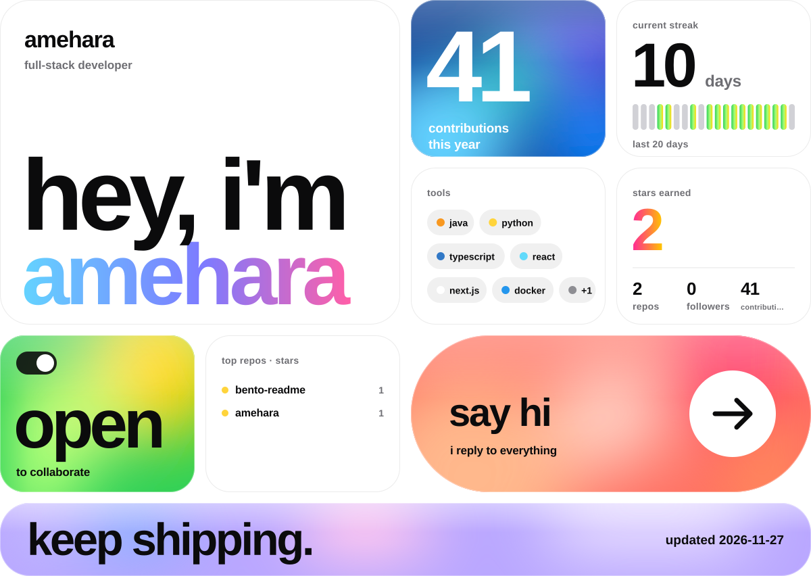

 

<!--
  bento.svg is regenerated every day by .github/workflows/update-bento.yml
  (scripts/fetch_stats.py -> stats.json -> scripts/generate.py -> bento.svg).
  Static texts (name, role, stack, "2+ years", links) live in scripts/generate.py.
-->
