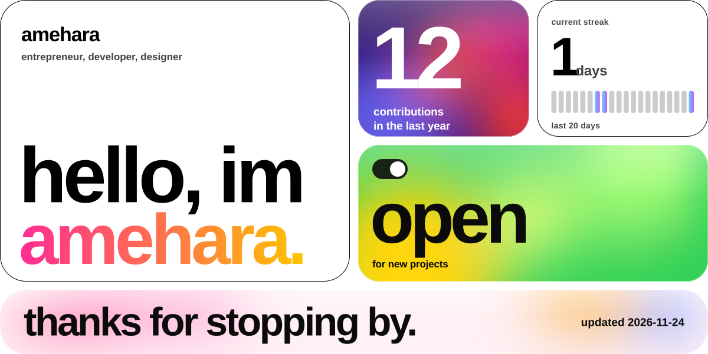

 

**[portfolio](https://your-site.com)** &nbsp;·&nbsp; **[email](mailto:you@email.com)** &nbsp;·&nbsp; **[linkedin](https://linkedin.com/in/your-user)** &nbsp;·&nbsp; **[behance](https://behance.net/your-user)**

<!--
  bento.svg is regenerated every day by .github/workflows/update-bento.yml
  (scripts/fetch_stats.py -> stats.json -> scripts/generate.py -> bento.svg).
  Static texts (name, role, stack, "2+ years", links) live in scripts/generate.py.
-->
